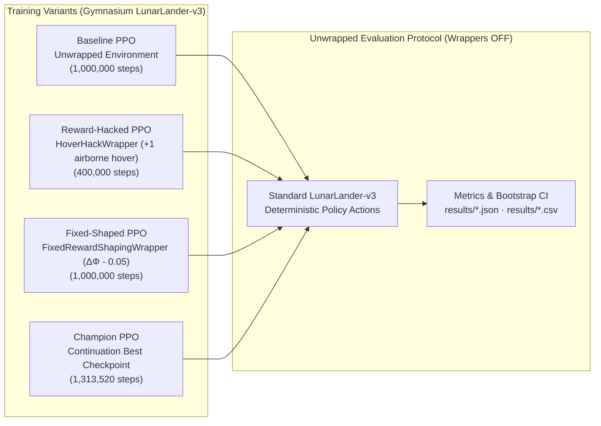
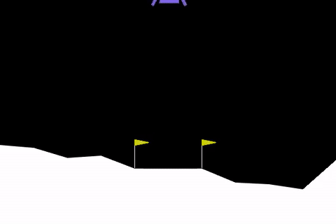
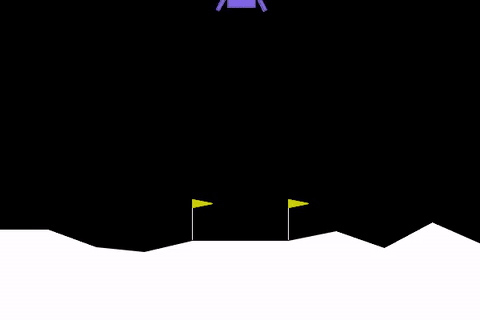
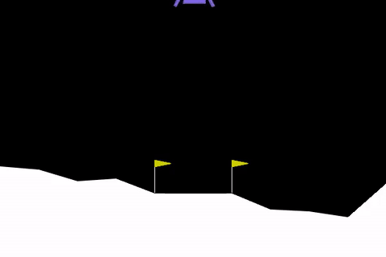

# Lunar Lander RL: Reward Shaping & Reward Hacking

[](https://github.com/manav4u/LunarLander-Reward-Shaping/actions/workflows/ci.yml)

An empirical reinforcement-learning study using **Gymnasium `LunarLander-v3`** and **Proximal Policy Optimization (PPO)**. It compares an untrained random policy, a baseline PPO agent, a deliberately flawed reward bonus that induces **reward hacking (specification gaming)**, and a frame-to-frame **potential-difference shaping** wrapper with a per-step time penalty.

---

## Experimental Pipeline & Evaluation Discipline

A common mistake in reward-shaping experiments is evaluating shaped policies with their custom training wrappers still attached, which conflates artificial shaping bonuses with true task performance. In this repository, **all checkpoints are evaluated strictly on the unwrapped `LunarLander-v3` environment (`custom_reward_wrappers = off`)**.



---

## Results Summary

### 1. Four-Stage Ablation (`results/benchmark_results.json`)

All PPO scores below were evaluated on the **unwrapped environment with custom reward wrappers OFF** over 10 deterministic episodes (the random policy reference is 1 episode). `LunarLander-v3` is conventionally considered solved around an average score of `200`.

| Agent | Training steps | Unwrapped evaluation score | Behavioral interpretation |
|---|---:|---:|---|
| Untrained random policy | 0 | `29.92` | Single-episode reference; crashes quickly |
| Baseline PPO | 1,000,000 | `269.41 ± 14.90` | Learns stable descent using the environment's native reward |
| Reward-hacked PPO (`HoverHackWrapper`) | 400,000 | `-56.07 ± 20.20` | Exploits the `+1` airborne hover bonus instead of landing; true task score collapses |
| Fixed-shaped PPO (`FixedRewardShapingWrapper`) | 1,000,000 | `266.54 ± 23.28` | Eliminates hovering and lands reliably; mean is close to baseline in this run |

The baseline and fixed-shaped means (`269.41` vs. `266.54`) are within one standard deviation in this 10-episode run; these results do **not** claim that the shaped agent outperforms baseline PPO. Full values are stored in [`results/benchmark_results.json`](results/benchmark_results.json) and [`results/benchmark_summary.csv`](results/benchmark_summary.csv).

### 2. 500-Seed Champion Checkpoint Benchmark (`results/final_champion_evaluation.json`)

The periodic-best continuation checkpoint (`models/ppo_lunar_lander_champion.zip`, `1,313,520` timesteps) was evaluated across **500 deterministic episodes** (`seeds 600000–600499`) with custom wrappers disabled:

| Metric | Result |
|---|---:|
| Evaluation episodes (`seeds 600000–600499`) | `500` |
| Mean unwrapped reward | `274.98` |
| Median unwrapped reward | `276.92` |
| Sample standard deviation | `27.15` |
| 5th-percentile reward | `239.09` |
| 10th-percentile reward | `246.97` |
| Episodes scoring `≥ 200` | `495 / 500` (`99.0%`) |
| Mean episode length | `247.5` steps |

A subsequent low-learning-rate fine-tuning candidate achieved a mean reward of `271.67` on the same 500 seeds (paired difference `+3.31` in favor of the champion checkpoint, 95% bootstrap CI `[0.33, 6.58]`), so the fine-tuned candidate was not promoted. Full details are recorded in [`results/final_champion_evaluation.json`](results/final_champion_evaluation.json).

---

## Visual Progression

| Stage 1 — Random policy | Stage 2 — Baseline PPO |
|---|---|
|  |  |
| [Original MP4](videos/1_random_crash.mp4) | [Original MP4](videos/2_baseline_ppo.mp4) |

| Stage 3 — Reward hacking (`HoverHackWrapper`) | Stage 4 — Fixed shaping (`FixedRewardShapingWrapper`) |
|---|---|
|  |  |
| [Original MP4](videos/3_hover_hack.mp4) | [Original MP4](videos/4_fixed_shaped.mp4) |

---

## Mathematical Formulation of the Reward Wrappers (`src/reward_wrappers.py`)

Let the 8-dimensional observation vector at step $t$ be:
$$s_t = [x_t, y_t, v_{x,t}, v_{y,t}, \theta_t, \omega_t, \ell_{1,t}, \ell_{2,t}]$$
where $(x_t, y_t)$ is lander position relative to the pad, $(v_{x,t}, v_{y,t})$ is linear velocity, $\theta_t$ is angle (tilt), $\omega_t$ is angular velocity, and $\ell_{1,t}, \ell_{2,t} \in \{0, 1\}$ are leg ground-contact indicators.

### 1. Flawed Bonus (`HoverHackWrapper`)
Adds a dense $+1.0$ step bonus whenever the lander is upright, moving slowly, and still airborne:
$$r'_t = r_t + \mathbb{I}\!\left(|\theta_t| < 0.25 \;\land\; \sqrt{v_{x,t}^2 + v_{y,t}^2} < 0.35 \;\land\; (\ell_{1,t} + \ell_{2,t}) = 0\right)$$
Because touching down sets $\ell_{1,t} + \ell_{2,t} > 0$ and terminates the episode, the agent discovers that hovering indefinitely collects more cumulative shaped return than landing—a textbook example of **specification gaming**.

### 2. Potential-Difference Shaping (`FixedRewardShapingWrapper`)
Defines a state potential function penalizing tilt, horizontal offset, and angular velocity:
$$\Phi(s_t) = -15|\theta_t| - 10|x_t| - 5|\omega_t|$$
and modifies the step reward using the undiscounted frame-to-frame potential difference plus a constant per-step time fee ($c = -0.05$):
$$r'_t = r_t + \bigl(\Phi(s_t) - \Phi(s_{t-1})\bigr) - 0.05$$
*Note on policy invariance:* Classic potential-based reward shaping (Ng, Harada & Russell, 1999) uses $\gamma \Phi(s_t) - \Phi(s_{t-1})$ without an additive step penalty to guarantee strict optimal-policy invariance. Here, $\Delta \Phi = \Phi(s_t) - \Phi(s_{t-1})$ with a $-0.05$ step fee is tested empirically as a practical shaping heuristic and evaluated against the true unwrapped task reward.

---

## Repository Map

```text
.
├── .github/workflows/ci.yml             # Automated unit tests for reward wrappers
├── README.md
├── requirements.txt
├── LICENSE
├── notebooks/
│   └── LunarLander_Reward_Shaping.ipynb # Interactive training & recording notebook
├── src/
│   └── reward_wrappers.py               # HoverHackWrapper & FixedRewardShapingWrapper
├── scripts/
│   ├── evaluate_models.py               # Reproducible multi-seed CLI evaluator
│   └── train_experiment.py              # Colab training & artifact export pipeline
├── tests/
│   └── test_reward_wrappers.py          # Unit tests for wrapper math & edge cases
├── models/
│   ├── ppo_lunar_lander_baseline.zip
│   ├── ppo_lunar_lander_hacked.zip
│   ├── ppo_lunar_lander_fixed.zip
│   └── ppo_lunar_lander_champion.zip
├── videos/                              # 4 MP4 originals + 4 GIF previews
└── results/                             # JSON + CSV evaluation benchmarks
```

---

## Run & Verify Locally

### 1. Install Dependencies

```bash
# Ubuntu/Debian system packages required for Box2D & video rendering
sudo apt-get update && sudo apt-get install -y swig ffmpeg
python -m pip install -r requirements.txt
```

### 2. Run Reward Wrapper Unit Tests

```bash
python -m unittest discover -s tests -p "test_*.py" -v
```

### 3. Reproduce Checkpoint Evaluations (`scripts/evaluate_models.py`)

Evaluate all four saved checkpoints over 10 deterministic seeds:

```bash
python scripts/evaluate_models.py --episodes 10 --start-seed 600000
```

Reproduce the 500-episode champion benchmark (`seeds 600000–600499`):

```bash
python scripts/evaluate_models.py \
  --models models/ppo_lunar_lander_champion.zip \
  --episodes 500 \
  --start-seed 600000 \
  --output-json results/reproduced_champion_eval.json
```

---

## Limitations

- **Single training seed per variant:** While the champion checkpoint is evaluated across 500 environment seeds (`600000–600499`), training multiple independent random seeds per wrapper configuration is required to establish variance across training runs.
- **Reward threshold vs. physical landing:** A score of `≥ 200` is the standard Gymnasium performance threshold proxy, not a direct geometric check that both landing legs came to rest between the flags on every episode.
- **Hardware/library sensitivity:** Box2D physics and PyTorch floating-point reductions can exhibit minor cross-platform drift across versions.

## References

- Schulman et al., [Proximal Policy Optimization Algorithms](https://arxiv.org/abs/1707.06347), 2017.
- Ng, Harada & Russell, [Policy Invariance Under Reward Transformations: Theory and Application to Reward Shaping](https://ai.stanford.edu/~ang/papers/icml99-shaping.pdf), ICML 1999.
