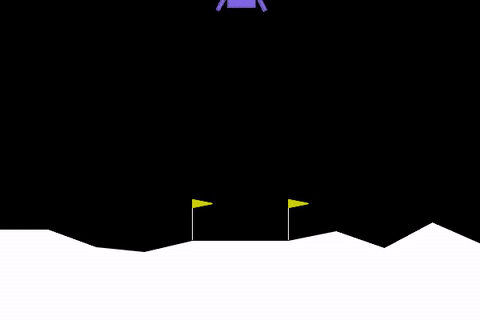
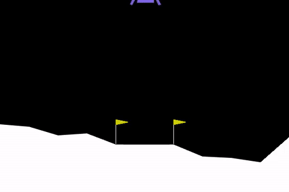
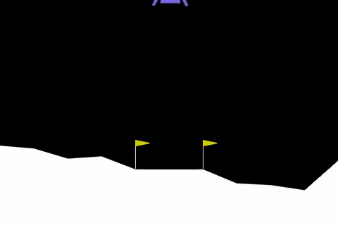

# Lunar Lander RL: Reward Shaping & Reward Hacking

An empirical reinforcement-learning experiment using **Gymnasium `LunarLander-v3`** and **Proximal Policy Optimization (PPO)**. It compares an untrained random policy, a baseline PPO agent, a deliberately flawed reward bonus that can incentivize hovering, and a potential-difference shaping experiment with a time penalty.

## Results from this run

All PPO scores below were evaluated on the **unwrapped environment with custom reward wrappers OFF**. PPO scores are deterministic evaluations over 10 episodes; the random policy entry is a single episode. The environment is generally considered solved around an average score of 200, but results depend on seed and training run.

| Agent | Training steps | Evaluation score | Interpretation |
|---|---:|---:|---|
| Untrained random policy | 0 | 29.92 | Single episode; a reference, not a stable estimate |
| Baseline PPO | 1,000,000 | 269.41 ± 14.90 | Learns using the environment's original reward |
| Reward-hacked PPO | 400,000 | -56.07 ± 20.20 | Raw task score falls despite the added training bonus |
| Fixed-shaped PPO | 1,000,000 | 266.54 ± 23.28 | Compared against the same unwrapped task score |

The baseline and fixed-shaped means are close in this run; the results do **not** establish that the shaped agent is better than baseline. Run more seeds and compare success rate, crash rate, episode length, and score distributions before drawing a stronger conclusion. Full values are stored in [`results/benchmark_results.json`](results/benchmark_results.json) and [`results/benchmark_summary.csv`](results/benchmark_summary.csv).

## Visual progression

| Stage 1 — Random policy | Stage 2 — Baseline PPO |
|---|---|
|  |  |
| [Original MP4](videos/1_random_crash.mp4) | [Original MP4](videos/2_baseline_ppo.mp4) |

| Stage 3 — Reward hacking | Stage 4 — Fixed shaping |
|---|---|
|  |  |
| [Original MP4](videos/3_hover_hack.mp4) | [Original MP4](videos/4_fixed_shaped.mp4) |

GIFs are short previews; the full recorded MP4s are retained in `videos/`.

## What the experiment demonstrates

1. **Baseline learning:** PPO can learn useful control behavior from the environment's eight-dimensional observation vector.
2. **Reward hacking / specification gaming:** a `+1` bonus for staying upright, slow, and airborne can reward behavior that does not accomplish the actual landing objective.
3. **Reward shaping experiment:** a frame-to-frame potential difference plus a per-step time fee attempts to encourage alignment and discourage wasting time.
4. **Evaluation discipline:** compare all policy variants with their training-only wrappers disabled so custom bonus rewards do not inflate evaluation scores.

## Method details

- **Environment:** Gymnasium `LunarLander-v3` (Box2D)
- **Algorithm:** Stable-Baselines3 PPO with an MLP policy
- **Observation:** horizontal position, vertical position, horizontal and vertical velocity, tilt, angular velocity, and two leg-contact indicators
- **Action space:** discrete main/side thruster controls
- **Evaluation:** deterministic policy actions; 10 episodes per PPO agent; custom wrappers off

The fixed wrapper in this repository uses `ΔΦ = Φ(sₜ) − Φ(sₜ₋₁)` and adds a `-0.05` per-step fee. This is the implementation tested here; it should not be described as a strict policy-invariance guarantee from the classic potential-based shaping theorem, whose usual discounted form uses `γΦ(s') − Φ(s)`.

## Repository map

```text
.
├── README.md
├── requirements.txt
├── LICENSE
├── notebooks/LunarLander_Reward_Shaping.ipynb
├── scripts/train_experiment.py
├── src/reward_wrappers.py
├── models/
│   ├── ppo_lunar_lander_baseline.zip
│   ├── ppo_lunar_lander_hacked.zip
│   └── ppo_lunar_lander_fixed.zip
├── videos/                 # 4 MP4 originals + 4 GIF previews
└── results/                # JSON + CSV metrics
```

## Run locally

Install the system dependency and Python packages:

```bash
# Ubuntu/Debian
sudo apt-get update && sudo apt-get install -y swig ffmpeg
python -m pip install -r requirements.txt
```

Evaluate a saved checkpoint (the model is evaluated with custom wrappers off):

```python
import gymnasium as gym
from stable_baselines3 import PPO
from stable_baselines3.common.evaluation import evaluate_policy

env = gym.make("LunarLander-v3")
model = PPO.load("models/ppo_lunar_lander_baseline.zip")
mean, std = evaluate_policy(model, env, n_eval_episodes=10, deterministic=True)
env.close()
print(f"Unwrapped score: {mean:.2f} +/- {std:.2f}")
```

## Limitations

- These are results from one run and do not establish statistical significance.
- Random-agent score is from one episode only.
- The reward-hacked behavior should be assessed from the clip and additional rollout metrics, not inferred from reward alone.
- The model files contain policy checkpoints, not a guarantee that training will reproduce identical results across hardware/library versions.

## References

- Schulman et al., [Proximal Policy Optimization Algorithms](https://arxiv.org/abs/1707.06347), 2017.
- Ng, Harada & Russell, [Policy Invariance Under Reward Transformations: Theory and Application to Reward Shaping](https://ai.stanford.edu/~ang/papers/icml99-shaping.pdf), ICML 1999.
